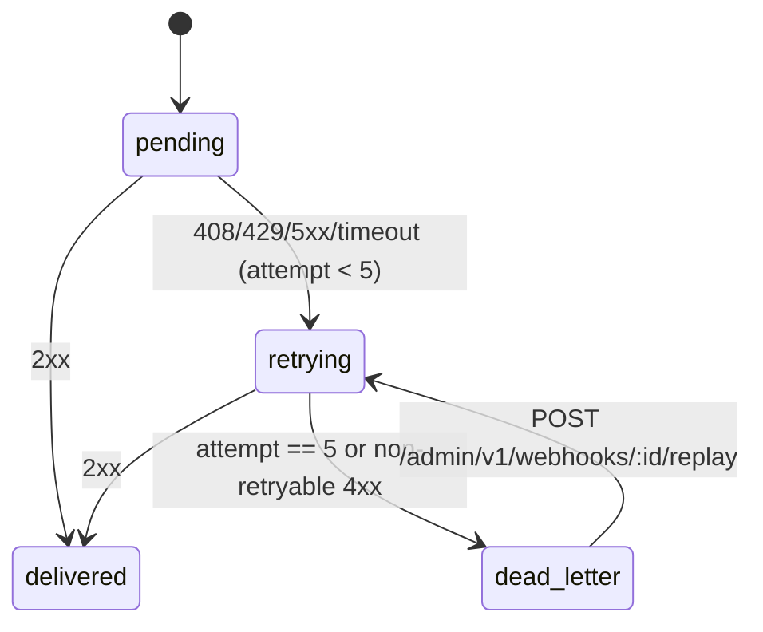

# RFC authoring and agent-ready blueprints

Scope: Authoring or reviewing an agent-ready RFC before `project-planning` ticket slicing.

## Mandatory pre-write grounding & Cortex memory

- **Inspect the repo BEFORE drafting Section 4:** Query `cortex_find(kind: "fact", query: "<domain>")` and `cortex_read` matching IDs first, then read actual migrations, schemas, routes, and workers. Never guess or omit table, column, or route names.
- Persist newly discovered **durable** invariants or accepted ADR decisions via `cortex_fact_put` (`topics` + `evidence`); never dump raw files or draft RFC prose into Facts.
- Record RFC lifecycle milestones via `cortex_event_append`.

## Concreteness & readability rules

- **No dense paragraphs:** Use short 1–2 sentence bullets, numbered steps, and Markdown tables instead of walls of text.
- **Simple language:** Write in plain, direct words; cut filler prose.
- **Explicit Schema & API:** Put table columns, types, defaults, indexes, HTTP methods/paths, JSON request/response shapes, and status codes in tables or code blocks—never bury them in prose.
- **Vague (Rejected):** *"Update the webhooks table to track retries and add an admin replay endpoint."*
- **Concrete (Required):** *"Add `attempt_count int DEFAULT 0` and `next_retry_at timestamptz` to `webhook_deliveries`; expose `POST /admin/v1/webhooks/:id/replay` returning `202` (`{"status":"retrying"}`) or `409` (`{"error":"not_dead_letter"}`)."*
- **Mermaid diagrams (when helpful):** Use `stateDiagram-v2` when an entity has >= 3 states, and `sequenceDiagram` when >= 3 components interact across async/network boundaries (avoid `Note over` syntax). Never repeat diagram arrows in prose; list only invariants/exceptions.
- **Three agent-readiness rules:** (1) Keep Section 7 empty before `project-planning` slicing; (2) Name both **reuse** and **avoid** `file#Symbol` anchors in Section 3; (3) Use Section 6's 3–5 vertical milestones as slicing boundaries.

## RFC template (strict)

```markdown
# RFC-[NNN]: [Short Feature or System Title]
- **Status:** Draft | In Review | Accepted  |  **Owner:** @[name]  |  **Related ADRs:** [None | `docs/adr/000X-...md`]

## 1. Context & Problem
[2–3 plain sentences explaining what is broken or missing, and why now.]

## 2. Goals & Non-Goals
- **Goals (In Scope):** [Measurable outcome 1]; [Measurable outcome 2]
- **Non-Goals (Out of Scope):** [What we are NOT building—feeds ticket `Out of Scope` guards]

## 3. Codebase Anchors (Verified)
- **Entry points / modules:** `internal/webhooks/dispatcher.go#Dispatch`, `internal/webhooks/store.go#WebhookDelivery`
- **Reuse:** [Exact helper, e.g., `pkg/retry/exponential.go#Backoff`, `internal/api/audit_handler.go#WriteError`]
- **Avoid:** [Deprecated pattern, e.g., `pkg/legacyqueue/poller.go#Poll`]
- **Downstream consumers:** [e.g., "`billing-metrics` reads `webhook_deliveries.status`; keep `delivered` and `failed`"]

## 4. Proposed Design

### Schema / Storage
| Table | Column / Index | Type & Default | Notes |
| :--- | :--- | :--- | :--- |
| `webhook_deliveries` | `attempt_count`, `next_retry_at`, `last_error` | `int` (0), `timestamptz` (null), `text` | Add `retrying`, `dead_letter` to `status` |
| `webhook_deliveries` | `idx_webhooks_retry` (partial index) | `(status, next_retry_at)` | `WHERE status = 'retrying'` |

### Worker / State Flow

- **Invariants:** Compute `next_retry_at` via `pkg/retry/exponential.go#Backoff`; increment `attempt_count` atomically on failure.

### API / Events
| Endpoint / Event | Behavior | Request / Response Shape |
| :--- | :--- | :--- |
| `POST /admin/v1/webhooks/:id/replay` | Reset `dead_letter` -> `retrying`, `attempt_count = 0` | `202`: `{"status":"retrying","attempt_count":0}` / `409`: `{"error":"not_dead_letter"}` |

### Failure Modes & Concurrency
| Failure / Race | Guard & Recovery |
| :--- | :--- |
| Two workers claim same `retrying` row | `FetchDueRetries` uses `SELECT ... FOR UPDATE SKIP LOCKED` |
| Downstream webhook hangs | 10s HTTP client timeout; treat timeout as retryable failure |
| Duplicate replay click | Atomic `UPDATE ... WHERE status = 'dead_letter'`; second call returns `409` |

## 5. Alternatives Considered & Rejected
| Option | Why Rejected |
| :--- | :--- |
| Kafka DLQ topic | Avoid operating a new broker for <500 events/min; Postgres partial index suffices (ADR-0014). |

## 6. Rollout & Verification Strategy
- **Feature flag & rollout:** Ship migration first; enable `WEBHOOK_RETRIES_ENABLED` in staging, then globally.
- **Vertical milestones (3–5 slicing boundaries):**
  1. Schema migration + store methods pass DB integration tests.
  2. Dispatcher retry/DLQ state machine verified with mock HTTP server tests.
  3. Admin replay endpoint + metrics verified end-to-end.

## 7. Open Questions (Must Be Empty Before Jira Slicing)
- [x] Retry `408`/`429` only; send other `4xx` to `dead_letter` -> **Decision:** Locked.
- [ ] [Open question] -> **Owner:** @[name] (Resolve before running `project-planning`)
```
